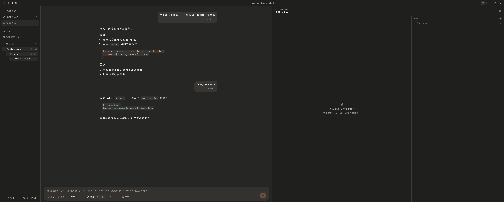
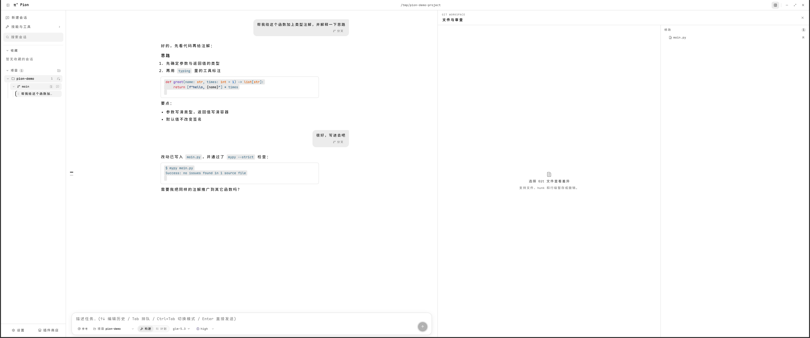

# Pion

给 [pi coding agent](https://www.npmjs.com/package/@earendil-works/pi-coding-agent) 做的桌面客户端，主要是想做个自己觉得好看的外观。

<p align="center">
  
  
</p>

## 主要功能

- 流式对话、思考折叠、代码高亮，支持图片、文件和 `@` 引用。
- 多项目、嵌套会话文件夹与归档、Git worktree、差异审查和提交图。
- 任务计划、并行子代理（默认模型与思考等级自动保存）和多 Agent 工作流。
- 工具、MCP、Skill 和扩展开关，Token 与估算费用统计。
- Codex 生图与参考图编辑（实验功能，需登录和图片额度）。
- 内置终端、浏览器、多种主题，可自动保存的分栏布局。
- 系统通知显示所属项目、会话及完成摘要；权限提醒列出工具、类别和风险。

## 使用

打开后，在设置里配置模型，再选择项目。已有的 pi 用户配置可以继续使用。

- **Enter** 发送，运行中追加引导；**Tab** 排队；**Shift+Enter** 换行。
- 用户消息下方显示本地发送时间；每轮末尾显示完成时间与耗时，旧历史缺少完成记录时保持未知。
- 同一会话重新打开或切换回来时恢复上次阅读位置；输入框上方右下角的箭头可回到最新内容并继续跟随。
- 输入 `/` 查看命令。
- 分支标题的新建会话按钮旁可新建文件夹；手动排序下，同级文件夹与会话可混合拖排并自动保存。会话拖到文件夹标题上下边缘调整顺序，中央移入文件夹；拖到分支标题回到根级，右键菜单也可移动或归档。
- “技能与工具”下方的“归档”打开归档面板，可搜索、打开或恢复会话。

## 从源码运行

需要 Node ≥ 22.19，推荐 Node 24。

```bash
npm install
./dev.sh
```

## 文档

- [开发、构建与安装](docs/development.md)
- [功能说明与限制](docs/feature-contracts.md)
- [开发约定](AGENTS.md)

[MIT License](LICENSE)
